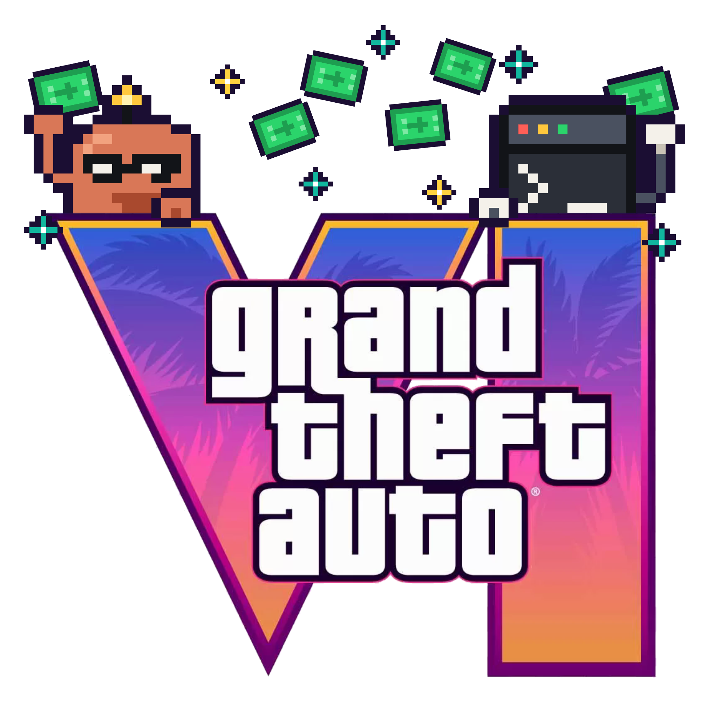
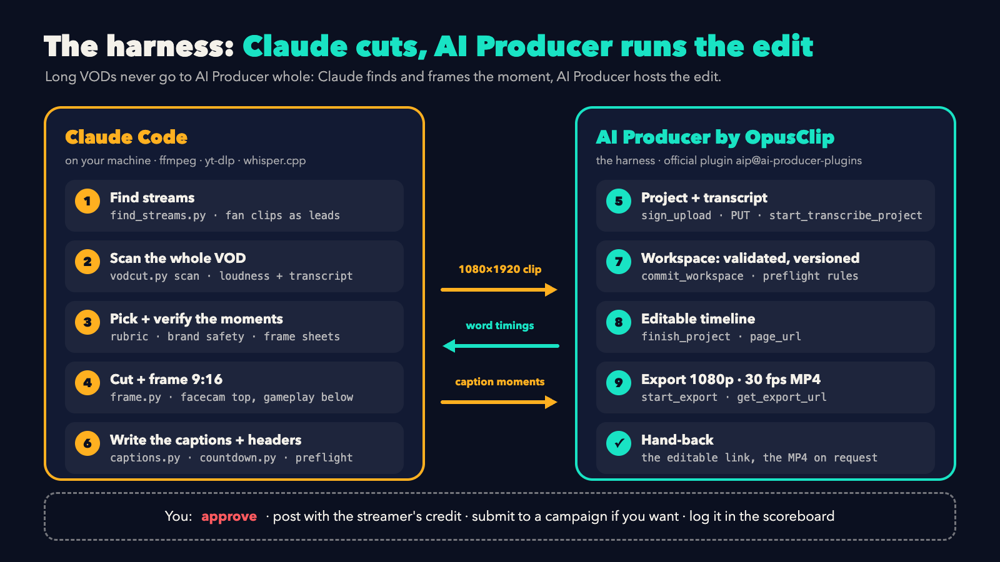

<div align="center">



# gtavi-aiproducer

<table><tr><td align="center">
<h3>The streamers made the moments.<br>Claude cuts them. AI Producer runs the edit.</h3>
</td></tr></table>

GTA 6 is out and the biggest streams on the internet are 20-hour VODs. Claude Code watches the whole VOD on your
machine, catches the seconds where the streamer loses it, cuts them 9:16 and opens each one in AI Producer, where the
captions, the timeline and the export live. You get an editable project link and a 1080x1920 clip.
Campaigns pay per 1,000 views. You decide what gets posted.

   
<br>
 

<br><br>


[Quick start](#quick-start) · [Make money](#make-money) · [Skills](#skills) · [Clip rules](#clip-rules) · [Scripts](#scripts)

</div>

---

## Quick start

**1. Install the harness: AI Producer's official plugin** (once)

```bash
claude plugin marketplace add https://github.com/opus-pro/ai-producer-plugin.git#main
claude plugin install aip@ai-producer-plugins --scope user
```

Start a new Claude Code session, run `/mcp`, choose `plugin:aip:ai-producer` and sign in with your OpusClip
account in the browser. AI Producer in coding agents is in beta and open to a limited set of accounts; if sign-in
is refused, that is why.

**2. Install this plugin**

```text
/plugin marketplace add steven-van-opus/gtavi-aiproducer
/plugin install gtavi-aiproducer@gtavi-aiproducer
```

It declares `aip@ai-producer-plugins` as a dependency, so Claude Code keeps AI Producer enabled alongside it.
gtavi-aiproducer already includes the /vodcut scan; install one or the other (see the FAQ).

**3. Local tools** (the scan and the cut run on your machine)

```bash
brew install ffmpeg yt-dlp whisper-cpp
mkdir -p ~/.cache/whisper && curl -L -o ~/.cache/whisper/ggml-large-v3-turbo-q5_0.bin \
  https://huggingface.co/ggerganov/whisper.cpp/resolve/main/ggml-large-v3-turbo-q5_0.bin
```

Python 3.9+ (standard library only). Node 18+ only if you re-render the README art.

**4. First run**

```text
/gtavi-aiproducer:streams speed
/gtavi-aiproducer:vodcut https://www.youtube.com/watch?v=<VOD_ID>
/gtavi-aiproducer:pick-moments
/gtavi-aiproducer:cut-and-frame 1,3
/gtavi-aiproducer:aip-project
/gtavi-aiproducer:aip-captions
```

Or say it in one line: *"Scan Kai Cenat's last GTA 6 VOD, cut the 3 best moments 9:16 and open them in AI Producer
with captions."*

## How it works



AI Producer is **the harness**. Claude does the parts AI Producer is not built for, and AI Producer hosts the edit:

| Step | Who | Why it is split this way |
|---|---|---|
| Find streams, scan the whole VOD, pick the moments | Claude, locally (yt-dlp, ffmpeg, whisper.cpp) | AI Producer sources are capped at about 30 minutes; a launch stream runs 20+ hours |
| Cut the window, compose 1080x1920 (facecam top, gameplay below) | Claude, locally (ffmpeg) | AI Producer keeps the source orientation: it never turns 16:9 into 9:16 |
| Upload, transcribe, host the project | AI Producer (`sign_upload`, `start_transcribe_project`) | word-level timings, an editable project, versions |
| Word-by-word captions, number headers, hook cards | Claude writes them, AI Producer validates and versions them (`commit_workspace`) | captions stay editable text in AI Producer's editor |
| Sound effects, finish, export | AI Producer (`place_sound_effects`, `finish_project`, `start_export`) | one MP4, up to 1080p and 30 fps, plus the editable link |

Our skills hand off to the official ones (`aip:aip`, `aip:aip-composition`, `aip:aip-dynamic-caption`,
`aip:aip-framing`) instead of copying them, and call the AI Producer tools by their Claude Code names
(`mcp__plugin_aip_ai-producer__<tool>`).

## Skills

| Skill | What it does |
|---|---|
| [`streams`](skills/streams/SKILL.md) | Find GTA 6 streams and VODs on YouTube, Twitch and Kick (read-only) |
| [`vodcut`](skills/vodcut/SKILL.md) | Watch a whole VOD locally: audio, whisper.cpp, loudness + reaction cues, ranked moments, frame sheets |
| [`pick-moments`](skills/pick-moments/SKILL.md) | Score moments with a rubric; brand-safety and Rockstar-policy checks; exact in/out |
| [`cut-and-frame`](skills/cut-and-frame/SKILL.md) | Download the exact window, measure the facecam, compose 1080x1920 30 fps, bleep if needed |
| [`aip-project`](skills/aip-project/SKILL.md) | Open the clip in AI Producer: pricing check, signed upload, transcription, editable link |
| [`aip-captions`](skills/aip-captions/SKILL.md) | Word-by-word GTA-style captions written into the AI Producer workspace, preflighted, committed |
| [`aip-export`](skills/aip-export/SKILL.md) | Finish, export 1080p30, download, deliver the link and the file |
| [`countdown`](skills/countdown/SKILL.md) | "5 craziest GTA 6 stream moments": the full prompt and the pipeline that builds it |
| [`reaction-edit`](skills/reaction-edit/SKILL.md) | You on camera reacting or explaining, the clip seated beside you |
| [`hooks`](skills/hooks/SKILL.md) | First two seconds, on-screen hook, title, cover text |
| [`post-copy`](skills/post-copy/SKILL.md) | Post text per platform with credits, campaign tags and disclosure |
| [`clip-rules`](skills/clip-rules/SKILL.md) | The checklist every clip passes before it goes out |
| [`campaigns`](skills/campaigns/SKILL.md) | Read-only campaign finder with honest payout math |
| [`scoreboard`](skills/scoreboard/SKILL.md) | Track every post; the learning loop writes `LEARNED_RULES.md` |
| [`launch-day`](skills/launch-day/SKILL.md) | Hour-by-hour playbook for launch days |
| [`media-page`](skills/media-page/SKILL.md) | Set up and run a GTA 6 edit page: the full setup prompt |

## Make money

Straight answer first: this plugin does not pay you, and nobody pays for a clip because it exists. Money comes
from **clipping campaigns** (brands and agencies paying per 1,000 views on approved clips) and from platform
programs, and both have rules.

What the campaigns looked like on GTA VI's launch day (snapshot of the Content Rewards feed, Nov 19, 2026):

- **About $1 per 1,000 views** was the median rate across 67 live CPM campaigns; 90% paid $2 or less.
- **Minimums:** $2-$35 per clip, so roughly 2,000-100,000 views before a clip earns anything.
- **Caps:** $35-$500 per clip, so earning stops somewhere between 50,000 and 500,000 views.
- **Fees:** Content Rewards keeps 10% of CPM and pool payouts.
- **Pools** split a fixed budget by views: a $10,000 pool across 100M qualifying views pays about $0.10 per 1,000.
- About **$70K of GTA VI clipping budgets** were listed on that one marketplace on launch day.
- Neither IShowSpeed nor Kai Cenat had a confirmed official clipping program; pools around streamers are run by
  independent agencies. Read each brief.

The math nobody puts in the thread: 810 clips at $1 per 1,000 views with a $10 minimum, a $500 cap and a 10% fee,
where most clips miss the minimum and a few hit the cap (`scripts/campaign_math.py`):

```bash
python3 -I scripts/campaign_math.py cpm --rate 1 --min 10 --cap 500 --fee 0.10 \
  --views 3000x770 --views 50000x30 --views 1000000x10
```

| views per clip | clips | pay per clip | subtotal | |
|---:|---:|---:|---:|---|
| 3,000 | 770 | $0 | $0 | below the minimum: $0 |
| 50,000 | 30 | $50 | $1,500 | paid at the rate |
| 1,000,000 | 10 | $500 | $5,000 | capped |

810 clips, 13,810,000 views. Naive views x rate: $13,810. Rate card gross: $6,500. After the fee: $5,850 (42% of
the naive figure).

*Illustrative math, not a promise. Most clips earn $0.* Rates, minimums and caps are set by each campaign and change
often. YouTube, TikTok and Instagram also stop paying for or recommending unoriginal re-uploads, which is why every
clip here is cut, framed, captioned and credited instead of re-posted. `campaigns` reads the live briefs for you
(read-only) and runs this math per campaign.

## Clip rules

Every clip passes [`clip-rules`](skills/clip-rules/SKILL.md) before it goes out. The short version:

- Credit the streamer on screen and in the post (`🎥 @IShowSpeed (YouTube)`). Credit is courtesy, not a license.
- Only footage from after the game was out; no endings or major story reveals; no cutscene on its own.
- No slurs, sexual content or private information; bleep profanity when the brief wants it.
- No "official", no implied endorsement, no streamer face next to a call to action.
- Follow each campaign's brief: platforms, credit wording, hashtags, no watermarks, deadlines.
- "#ad" first and the platform's paid-partnership setting on whenever you are paid for a post.
- No bots, bought views or mass re-uploads. Keep the provenance file of every clip.

## Scripts

Standard-library Python (run with `python3 -I`) plus ffmpeg, yt-dlp and whisper.cpp. Every script answers `--help`.

| Script | What it does |
|---|---|
| `vodcut.py` | The VOD pipeline: `scan`, `find`, `verify`, `cut`, `prep`, `report`. Post-live VODs still served as 2-second fragments go through `ytfrag.py`; processed VODs through yt-dlp (it asks yt-dlp which before every download) |
| `ytfrag.py` | Exact windows or whole tracks of YouTube post-live VODs still served as 2-second fragments (where yt-dlp sections fail); rotates throttled URLs, resumes, retries, and stops on a processed VOD |
| `scan_vod.py` | Loudness + chunked whisper.cpp transcription of a whole stream, resumable |
| `scan_frags.py` | Transcribes 20-minute chunks while `ytfrag.py track` is still downloading (fragment-served VODs only) |
| `rank_windows.py` | 30 s windows ranked by loudness, reaction cues and speech; whisper loops cleaned; review flags; distinct moments |
| `framesheet.py` | 12 frames of a clip in one image, to verify a moment by eye |
| `frame.py` | 9:16 composer: `grid` to measure the facecam, `still` to check, `compose` to write 1080x1920 30 fps |
| `bleep.py` | Word-level timings and baked-in bleeps (or mutes) before upload |
| `aip_prep.py` | Checks a clip against AI Producer's limits, prints the `sign_upload` arguments, writes provenance |
| `captions.py` | GTA-style caption moments from AI Producer's `caption_cues.py` output |
| `aip_mount.py` | Mounts moment hosts last inside the AI Producer root, lists tracks, unmounts for a recut |
| `countdown.py` | Joins countdown items frame-exact and writes the title and number-header moments |
| `campaign_math.py` | What a campaign's rate card actually pays |
| `scoreboard.py` | Post log, report, and the learning-loop rules |
| `find_streams.py` | Read-only stream and VOD search through yt-dlp |
| `render.mjs` | HTML to PNG (this README's art) and HTML timelines to frames, with your installed Chrome |

Tests: `python3 -I -m unittest discover -s tests -v`. The caption and countdown tests also run AI Producer's own
`caption_cues.py` and `preflight.py` when the official plugin is installed.

```text
.claude-plugin/   plugin.json, marketplace.json (single-plugin marketplace)
assets/           plugin icon
docs/             hero, mascot, harness diagram, badges (HTML/SVG sources next to the PNGs), ABOUT.md
scripts/          the tools above
skills/           16 skills, one folder each
tests/            unittest suite + an offline AI Producer workspace fixture
```

## FAQ

**Does AI Producer find the best moments in a stream?** No. That is Claude's job here (`vodcut`). AI Producer edits
a clip once it exists, and its sources are capped at about 30 minutes (15 in the web app guide).

**Does AI Producer turn a 16:9 stream into a vertical video?** No. It keeps the source orientation. `frame.py`
composes the 1080x1920 frame before upload.

**Can I paste a Twitch or Kick link into AI Producer?** Its link download takes YouTube, TikTok and Instagram only,
with no time range. Download the window locally (`vodcut.py cut` handles YouTube, Twitch and Kick) and upload it.

**Is it free?** The scan and the cut run on your machine. AI Producer is free to start and in beta; the planning runs
on your Claude plan and some AI Producer steps can use OpusClip credits. The skills read the live price with
`get_pricing` before anything runs and say so when a step costs.

**What does the export look like?** One MP4 per project, up to 1080p and 30 fps, 9:16 here. The editable project link
is the default delivery; the MP4 is rendered when you ask for it.

**Does it post for me?** No. Nothing here posts, schedules, joins campaigns or signs in anywhere for you. To queue your exports, upload them to [OpusClip](https://www.opus.pro)'s scheduler (Pro).

**The install said `dependency "aip@ai-producer-plugins" was not installed`.** Add AI Producer's marketplace first
(Quick start, step 1), then run the install again: with that marketplace added, Claude Code installs `aip` for you
as a dependency. Without it, this plugin installs but does not load.

**Which streamers?** Any. The examples use IShowSpeed and Kai Cenat because they streamed GTA VI for most of launch day.
Measure each streamer's facecam once per layout.

**Do I also need the standalone /vodcut?** No. gtavi-aiproducer already includes the /vodcut scan
(`/gtavi-aiproducer:vodcut`), and the cut, AI Producer and caption steps are its other skills. Install one or the
other: both ship a skill named `vodcut`, so with both installed a bare `/vodcut` goes to whichever loaded first.

**Who made this? Is it official, or affiliated with Rockstar, IShowSpeed or Kai Cenat?** It isn't AI Producer's
official plugin (that's `aip@ai-producer-plugins`, which this one depends on), but it isn't independent of OpusClip
either: steven-van-opus made it for OpusClip's GTA 6 launch campaign. It's open source and uses AI Producer through the
official `aip` plugin. It is not affiliated with or endorsed by Rockstar Games, Take-Two Interactive, IShowSpeed or
Kai Cenat. The GTA VI logo in the header art is Take-Two Interactive's trademark, shown only to identify the game; the
pixel buddies and the rest of the art are original.

## Disclaimer

**Who made this.** steven-van-opus made this plugin for OpusClip as part of OpusClip's GTA 6 launch campaign, so it is not an
independent review or recommendation of OpusClip or AI Producer.

Not affiliated with or endorsed by Rockstar Games, Take-Two Interactive, IShowSpeed or Kai Cenat. Grand Theft Auto,
GTA and the GTA VI logo in the header art are trademarks of Take-Two Interactive; the rest of the art is original.
Stream footage belongs to its owners:
credit them, keep clips short and transformed, follow Rockstar's video policy and every campaign's brief, and take
a clip down when asked. AI Producer and OpusClip are products of OpusClip; this plugin uses them through the
official `aip` plugin and does not change how they work. Nothing here is legal or financial advice. Earnings depend
on views, minimums, caps and fees; most clips earn $0.

MIT licensed. See [LICENSE](LICENSE).
